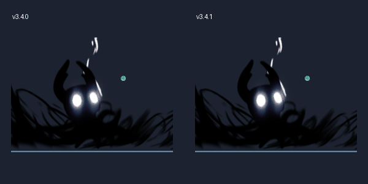
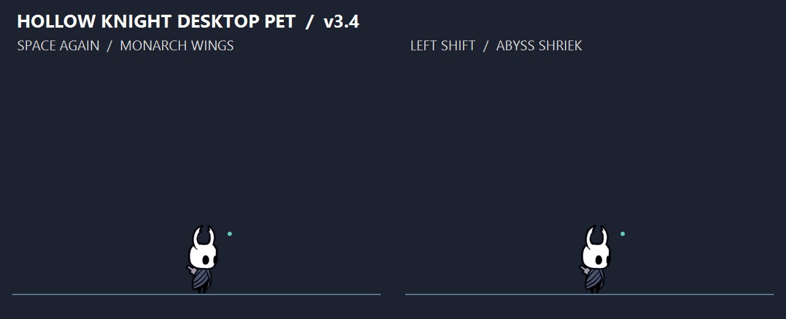
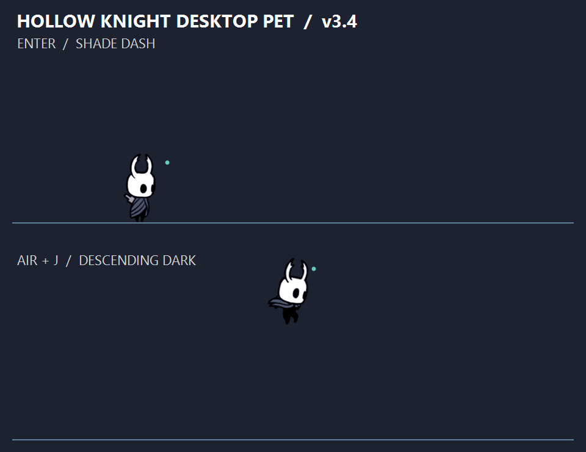

# 空洞骑士桌宠 v3.4.1

双击 `app/HollowKnightPet.exe` 即可运行。面向 Windows 10 / 11 x64，已包含 .NET 运行时，无需安装 Python 或 .NET，也不需要管理员权限。

## 操作

| 操作 | 功能 |
| --- | --- |
| 左键点击角色 / 按鼠标侧键 | 激活键盘控制，绿色小点表示已激活 |
| A / D | 向左 / 向右移动 |
| Space | 短按小跳，长按高跳；空中再次按下二段跳，吸附时蹬墙跳开 |
| Enter / 回车 | 黑冲，按当前方向瞬间移动；空中也可使用 |
| J | 地面朝面向方向挥刀；空中释放黑砸 |
| 左 Shift | 地面 / 空中释放黑吼，右 Shift 不触发 |
| 点击其他应用 / 切换窗口 / Esc | 停止操控并清空按键、取消攻击与特殊动作；再次点击角色或按鼠标侧键 激活 |
| 鼠标左键拖动角色 | 移到其他位置或窗口上方，松手后自然下落 |
| F8 | 切换暂停状态；恢复后仍需点击角色或按鼠标侧键 激活，重力继续生效 |
| F9 | 回到鼠标所在显示器的任务栏上方 |
| 右键角色或系统托盘图标 | 设置吸附、碰撞、刷怪开关 / 频率，清空怪物、复位、退出 |
| 双击托盘图标 | 暂停 / 恢复键盘控制 |

## v3.4.1：黑砸恢复过渡

黑砸落地恢复的最后约 0.19 秒采用原作恢复帧之间的渐变，校准面部位置并接到当前普通姿态，让黑色轮廓消退、面具显现和起身连续完成。颜色与透明度一起混合，避免角色在过渡中整体变淡；脚下绘制边界保持在落地点。

黑砸仍按原始速度的 1.1 倍播放，总恢复时间约 0.527 秒。改动只涉及末段角色绘制，技能特效、伤害、冷却、移动及其他操作参数保持 v3.4.0 设置。



## v3.4：二段跳与黑吼

跳起后松开 Space，再次按下即可二段跳，播放原作帝王之翼动作与羽翼特效。每次腾空可使用一次；落到任务栏 / 窗口顶部，或成功吸附墙面后恢复。按住 Space 不会自动连续跳。二段跳仍支持短按 / 长按控制高度，不能在空中继续三段跳；蹬墙跳保留空中二段跳次数。切换应用或释放技能不会补回已经用掉的二段跳。

按 **左 Shift** 释放黑吼；右 Shift 不触发。可在地面、空中或贴墙状态使用，施法期间暂停移动与下落。经过 0.10 秒蓄力、0.65 秒爆发和约 0.12 秒恢复；冷却 1.1 秒，从施法开始计时。黑吼朝角色上方和近身范围造成四次伤害，每次 1 点，同一波不会重复伤害同一只怪物。采用原作黑吼角色动作、虚空面孔爆发和地面波纹。和其他技能一样，不消耗灵魂，也不会伤害角色。

黑砸落地角色动作及特效改为原始速度的 **1.1 倍**，恢复约 0.527 秒。此前本地增加的黑冲距离（300 px）与冷却（0.5 秒）一并保留并发布。



## 黑冲与黑砸

激活角色后，按 **回车** 黑冲；按住 A / D 时采用输入方向，没有方向输入时采用面向方向，吸附时默认朝远离墙面的方向冲开。冲刺速度 1200 px/s，持续 0.25 秒，无障碍时移动 300 px，冷却 0.5 秒。冲刺中暂时停止重力，随后正常下落；有虚空拖尾和恢复动画。屏幕边界和实体窗口侧边仍阻挡冲刺，冲刺过程不触发自动吸附。

在空中按 **J** 黑砸：蓄力 0.25 秒后以 1600 px/s 下坠，接触任务栏或可见窗口顶部后播放虚空波纹、爆发和恢复动画。蓄力及下坠期间锁定左右移动，落地动作和虚空特效统一以原始速度的 1.1 倍播放，恢复约 0.53 秒。地面 J 保留普通挥刀；Space 与 J 同时按下时先起跳再黑砸。冷却中的操作不自动排队。

这是桌宠战斗适配：没有灵魂消耗；黑冲对路径上的每只怪物造成一次 1 点伤害，黑砸下坠命中造成 1 点，落地范围命中造成 2 点。爬虫有 2 点生命。切换应用、Esc、暂停、拖动或复位会立即取消特殊动作；冷却继续计时。黑砸从贴墙状态也能释放。

特殊动作与法术共 128 帧原作素材，以原始像素缓存并保持脚底锚点。角色图像约按原尺寸的 88% 显示；采用高质量缩放，避免额外 DPI 放大和裁切，不进行 AI 补帧。物理更新为 120 Hz，绘制随系统定时器运行；最终 EXE 的短时动作运行检查约为 62 FPS。透明绘制区域扩大到 720×480，特效区域可穿透鼠标点击。帧率随设备和桌面负载变化。



## 保留的 v3.2 更新

默认使用鼠标后退侧键（XButton1）激活角色。右键角色或托盘 →“鼠标侧键激活”，可以改用前进侧键（XButton2），也可以关闭；设置自动保存。选中的侧键专用于桌宠激活，会拦截它原有的浏览器前进 / 后退动作；未选中的侧键照常使用。关闭后两个侧键均恢复原功能。

右 Alt 激活已移除。点击角色仍然可以激活。鼠标驱动需要将对应侧键设为标准后退 / 前进键（XButton1 / XButton2），而非自定义键盘宏。

## 保留的 v3.1 更新

- 修复刷怪打断操控：怪物图层使用不激活窗口的原生显示方式，连续生成和清除怪物不会清空正在按住的移动、跳跃或攻击输入。
- 移速在 v3 的基础上再提高 15%，由 381.8 调整至 439.07 px/s。跳跃高度保持原有设置。
- EXE、角色窗口及托盘统一使用 Steam 提供的《空洞骑士》游戏图标，包含 16–256 像素多种尺寸。

## 控制与刷怪

启动后角色处于未激活状态，点击角色或按鼠标侧键 后才接收 A、D、Space、Enter、J、左 Shift。使用的是角色窗口的本地键盘消息，不再轮询其他应用中的全局移动按键。切换到其他应用时立即清空输入、取消挥刀、黑冲、黑砸、黑吼及上升指令，重力与环境动画继续运行。切回程序也不会自动恢复操控，需要再点击角色或按鼠标侧键。角色上的暂停徽标表示未激活或已暂停。

侧边吸附每次启动默认开启，但普通地面走动不会触发。只在跳起 / 空中靠近屏幕或窗口侧边，或者把角色拖到侧边松手时吸附。单击和拖拽有位移阈值，单击激活不会把角色误当成拖拽。

怪物默认开启，每 15 秒在随机显示器的工作区底部生成一只原作爬虫。它们沿任务栏上沿缓慢往返走动，最多同时 6 只，存活超过 3 分钟会清理。生成位置会避开角色及已有怪物。怪物图层不接受鼠标操作，可以直接点击下面的任务栏或应用。

激活角色后在地面按 J 挥刀攻击，命中范围随朝向变化，每次挥刀只对同一只怪物造成一次伤害。怪物两次命中后消失，受击时闪光、后退并显示剩余血量；目前是练习用怪物，不会伤害角色。

右键菜单提供：

- **任务栏随机刷怪**：关闭时立即清除当前怪物。
- **刷怪间隔**：5 / 10 / 15 / 30 / 60 秒预设，或自定义 2–300 秒。间隔修改后重新计时。
- **立即生成一只**：刷怪功能开启且未到数量上限时生效。
- **清空当前怪物**：清场，不改变刷怪开关。

侧键选择、刷怪开关和间隔保存到 `%LOCALAPPDATA%/HollowKnightPet/settings.json`，重启后恢复。菜单关闭后需点击角色或按鼠标侧键 重新激活。

## 保留的移动与窗口功能

- 移动速度在 v3 基础上再提高 15%，从 381.8 px/s 调整为 439.07 px/s，空中移动也同步加快。
- 侧边吸附时的精灵图已水平翻转，屏幕和窗口两种吸附使用一致的朝向规则。
- 可见窗口的左右侧边支持空中 / 拖拽吸附。默认平台模式和实体碰撞模式都能使用，普通地面行走不吸附。
- 窗口移动时角色跟随；缩放后跟随对应侧边。窗口关闭、最小化、侧边被前方窗口遮挡，或缩小到不再覆盖吸附位置时，角色脱离下落。
- 按远离窗口的方向键脱离，Space 蹬开，保留 0.25 秒吸附冷却。右键“屏幕 / 窗口侧边自动吸附”统一控制此功能。

## 动画与手感

角色采用原作 PNG 逐帧动画，包含 50 帧移动素材和 26 帧原始挥刀素材；当前轻攻击使用挥刀素材的前 4 帧，叠加程序绘制的刀光。爬虫使用原作精灵表中的 4 帧行走动作。黑冲、黑砸、二段跳和黑吼另有 74 帧原始特殊动作 / 拖尾与 54 帧法术特效。素材已嵌入 EXE，运行时无需联网或额外图片文件。

水平移动改为即按即动、松手即停，空中可以立即转向。跳跃采用有限时间的持续上升，松开空格后切断上升，保留离地宽限和落地前输入缓冲。

空中靠近屏幕左右外侧边缘时自动吸附，显示贴墙动作并停留在当前高度。按反方向（左侧按 D，右侧按 A）离开，按 Space 蹬墙跳开，也可以用鼠标拖离。脱离后有 0.25 秒吸附冷却，避免立即被吸回。右键菜单可以关闭吸附。相邻显示器的连接处不吸附，允许跨屏移动；拖到侧边后松手也会吸附。

“侧边缘”采用显示器工作区边界：如果任务栏停靠在侧面，角色吸附在该工作区边缘。这里的永久停留是桌宠功能，和原作会下滑的墙面行为有所区别。

移动速度根据社区移植项目的原版骑士预制体参数按 40 桌面像素 / 游戏单位换算，经过两次各 15% 的加速：跑速 439.07 px/s，起跳速度 666 px/s，下落速度上限 800 px/s；实测最短跳约 54 px、完整跳约 239 px。采用 120 Hz 物理更新；速度倍率、重力、输入宽限及吸附是桌面适配值，并非原游戏逐帧一致的完整复刻。

刷怪不会抢走焦点或打断控制；用户点击角色或按鼠标侧键 后才接收操作输入。侧键使用全局鼠标钩子识别，并在按下时请求激活窗口，A/D、Space、Enter、J、左 Shift 仍使用角色窗口的本地消息。F8 / F9 仍是全局管理快捷键，如果已被其他软件占用，可使用右键菜单。

## 碰撞方式

- 默认是平台模式：窗口上边缘可以站立，从下方起跳可以穿过窗口并落到顶部；可以从侧边走下去。
- 右键勾选“实体窗口碰撞”后，额外检测窗口侧边和底边。
- 任务栏位置通过显示器工作区获取，脚底停在工作区下边缘；任务栏自动隐藏时，地面通常位于屏幕底部。
- 大约每 80 毫秒刷新可见顶层窗口边框。排除本程序、桌面、工具浮窗、最小化窗口和被系统隐藏的窗口。
- 平台模式会裁掉被前方窗口遮住的顶部区段；实体模式使用窗口矩形作为近似，不模拟圆角或应用内部控件。
- 脚下窗口移动时，角色跟随；窗口关闭或最小化后，角色下落。
- 如果新打开、拖动或最大化的窗口包住角色，允许角色自然离开，避免突然被弹走。
- 完整跳跃高度约 239 像素。较高的窗口可以先把角色拖到上方，再松手降落。

支持多显示器坐标及负坐标；本次真实运行验证使用单台 2560×1440 显示器。混合缩放、多显示器布局和特殊全屏应用尚未做实机验证。角色固定使用像素尺寸，超高分辨率下会显得较小。

## 文件

- `app/HollowKnightPet.exe`：独立可执行文件。
- `src/`：完整 C# / WinForms 源码。
- `build.ps1`：重新编译和打包脚本，需要 .NET 9 SDK。

源码主要文件：`Program.cs` 管理桌宠窗口与菜单；`Controls.cs` 管理激活、按键及设置；`ActivationShortcut.cs` 识别鼠标侧键；`Combat.cs` 管理刷怪和攻击；`CombatArt.cs` 绘制怪物和刀光；`Physics.cs` 处理运动、碰撞和吸附；`Native.cs` 枚举窗口并显示透明图层；`SpriteArt.cs` 管理普通动画；`Abilities.cs` / `AbilityArt.cs` 管理黑冲、黑砸、黑吼与羽翼特效；`AbilityPreview.cs` 导出动作预览；`Assets/` 保存原始 PNG；`Tests.cs` 提供自动测试。

## 编译

在当前文件夹打开 PowerShell：

```powershell
./build.ps1
```

或者直接运行：

```powershell
dotnet publish ./src/HollowKnightPet.csproj -c Release -r win-x64 --self-contained true -p:PublishSingleFile=true -p:EnableCompressionInSingleFile=true -p:IncludeNativeLibrariesForSelfExtract=true -p:DebugType=None -o ./app
```

## 验证结果

已通过 73 项逻辑测试和 54 项真实窗口交互检查。新增覆盖二段跳次数限制、额外高度、窗口落地与贴墙恢复、失焦和施法不重置次数，以及黑吼的地面 / 空中暂停、四波伤害、向上攻击范围、互斥、冷却、左右 Shift 区分和刷怪不中断施法。原有碰撞、跳跃、吸附、侧键激活和战斗检查均通过。报告见 `测试结果.txt`。

最终独立 EXE 的四秒动作运行检查实际经过全部九种技能状态并触发二段跳，加载 76 帧普通角色素材与 128 帧特殊动作 / 法术素材，绘制 250 帧，约 62.3 FPS。已检查羽翼、黑吼、冲刺与黑砸预览及双向透明画布。测试使用单台 2560×1440 显示器，混合 DPI、多显示器和特殊全屏软件未做全面实机验证。

可运行内置检查，将报告写到指定绝对路径：

```powershell
Start-Process ./app/HollowKnightPet.exe -ArgumentList '--self-test',"$PWD/tests.txt" -Wait
Start-Process ./app/HollowKnightPet.exe -ArgumentList '--smoke-test',"$PWD/smoke.json" -Wait
Start-Process ./app/HollowKnightPet.exe -ArgumentList '--ability-smoke-test',"$PWD/abilities.json" -Wait
# 以下交互测试会短暂显示测试窗口并模拟鼠标侧键、移动光标，运行时请暂勿操作鼠标键盘。
Start-Process ./app/HollowKnightPet.exe -ArgumentList '--focus-test',"$PWD/focus-tests.txt" -Wait
```

若路径包含空格，请对传入的报告路径额外加引号。异常日志位于 `%LOCALAPPDATA%/HollowKnightPet/error.log`。

## 美术与实现说明

角色来源：[The Spriters Resource — The Knight (Ghost)](https://www.spriters-resource.com/pc_computer/hollowknight/asset/533865/)，上传者 VincTBest。怪物来源：[The Spriters Resource — Crawlid](https://www.spriters-resource.com/pc_computer/hollowknight/asset/131852/)，上传者 Lulubalu。原始图片保持不变，显示时取帧、缩放和镜像。素材及角色版权归 Team Cherry；本桌宠并非官方产品。详细来源和参数依据见 `素材与参数来源.md`。

窗口边界使用 Windows DWM API：
[Microsoft：DWMWINDOWATTRIBUTE](https://learn.microsoft.com/en-us/windows/win32/api/dwmapi/ne-dwmapi-dwmwindowattribute)。
